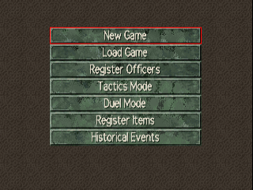
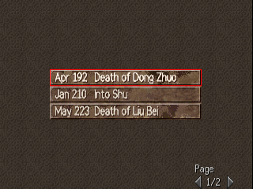
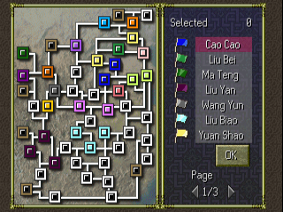
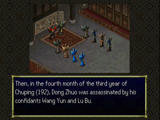
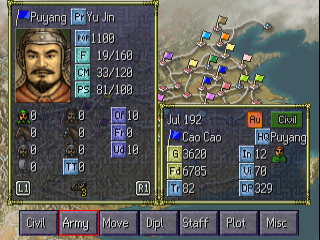
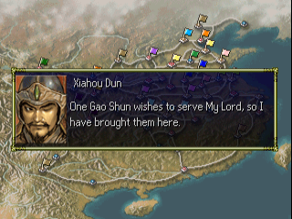
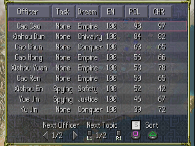
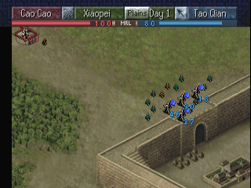
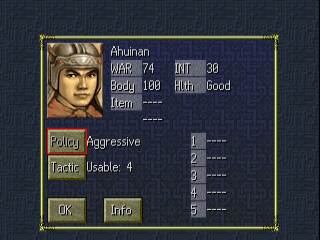

# Sangokushi VI with Power-Up Kit — English Translation

A fan translation of **Sangokushi VI with Power-Up Kit** (三國志VI with パワーアップキット, Koei, 1999)
for the PlayStation into English. *Sangokushi VI* is the sixth *Romance of the Three Kingdoms*:
you rule a force in 2nd–3rd century China, govern your cities, recruit officers and fight hex-map
battles to unify the land. The base game was released in English as *Romance of the Three
Kingdoms VI: Awakening of the Dragon*; the Power-Up Kit edition, which adds new full and
short scenarios, the Tactics Mode (twenty historical battles), an item editor, new events and
more, was only released in Japan.

> **This is a full machine translation.** All of the game's text was translated from
> Japanese by an AI model, not by a human translator, and it has not been
> proofread by a fluent Japanese speaker. Expect occasional mistranslations, awkward
> phrasing and inconsistent terms. Corrections are welcome. Officer names, places and
> game terms follow the official English release of the base game where it has them;
> none of its text is used in the patch.

> **This is a beta (v0.9.1).** All of the game's text is in English and the main screens
> have been played through, but not every battle screen and event has been seen yet.
> Expect some text that is squeezed, cut short or wrapped oddly.

This repository contains the English text and the tools that build the patch.
It does **not** contain the game, any of its data, or the Japanese script — you need
your own copy of the game.

## Screenshots

| | | |
|:-:|:-:|:-:|
|  |  |  |
| Main menu | Scenario select | Ruler select |
|  |  |  |
| Historical event | Strategy map | Dialogue |
|  |  |  |
| Officer list | Battle | Duel setup |

## What's translated

- All of the game's message text: advisor reports, diplomacy and plots, war and duel
  messages, historical events (including the Power-Up Kit's new ones), scenario
  introductions and victory conditions, the chronicle, help pages, the tutorial and
  memory card messages (save titles in the memory card manager too)
- All officer biographies
- Menus, labels, buttons and system messages, including the officer and item editors,
  the Tactics Mode and the duel and tournament screens
- 550 historical officers and the other event characters, romanised (Three Kingdoms names
  as in *Romance of the Three Kingdoms VI* and *Sangokushi DS 3*), plus cities, items,
  titles, ranks and scenario titles
- Dates in English ("Apr 192")
- Graphics: title logo, main menu and scenario list, editor buttons and tiles, map icons,
  battle and duel labels, and the Tactics Mode banners, redrawn at build time with an
  original English font
- A proportional English font (original drawings) with word wrap
- **English name entry**: new officers and force names are entered with a letter grid
  (A–Z, a–z, ’ - .); the Japanese kana grid is still there, the kanji picker is disabled

Long names and labels are shortened where the game's boxes are too small.

## Applying the patch (players)

1. Download the release zip (`Sangokushi_VI_PUK_English_v<version>.zip`) from the Releases
   page. It contains the patch `sangokushi_6_puk_en_v<version>.xdelta`, a `.cue` file and
   a README.txt.
2. You need an unmodified image of the Japanese disc (serial `SLPM-86312`) in the usual
   two-track BIN/CUE form (Redump). Only track 1 is patched:

   | Track 1 | |
   |---|---|
   | Size  | 139,414,800 bytes |
   | CRC32 | `A656871B` |
   | MD5   | `7f0dfd3b2cabf1b8ce67a3749b5809f2` |
   | SHA-1 | `e4c4506ce78a8327a27506a7301c910dc185db6e` |

   Track 2 (CD audio, 37,810,752 bytes, CRC32 `40E86050`) is used unchanged.
3. Apply the patch to track 1 with an xdelta tool, e.g.
   [Delta Patcher](https://github.com/marco-calautti/DeltaPatcher) or the command line:

   ```
   xdelta3 -d -s "Sangokushi VI with Power-Up Kit (Japan) (Track 1).bin" sangokushi_6_puk_en_v<version>.xdelta "Sangokushi VI with Power-Up Kit (English v<version>) (Track 1).bin"
   ```

4. Put the zip's `Sangokushi VI with Power-Up Kit (English v<version>).cue` next to the patched
   track 1 and the original track 2, and open the `.cue` in your emulator.

The patched disc has the same serial, so it uses the same memory card saves as the
Japanese game.

## Building from source

Requirements: Python 3.10+, `xdelta3` (for the patch file).

```
python -m venv .venv
.venv/bin/pip install -r requirements.txt
cp "/path/to/Sangokushi VI with Power-Up Kit (Japan) (Track 1).bin" sangokushi_6_puk_track1.bin
cp "/path/to/Sangokushi VI with Power-Up Kit (Japan) (Track 2).bin" sangokushi_6_puk_track2.bin
.venv/bin/python tools/setup.py      # checks the disc, extracts script/ from it, checks tl/
.venv/bin/python tools/build.py      # writes build/sangokushi_6_puk_en_track1.bin (+ track 2, .cue) and the .xdelta
```

`tools/setup.py` checks the disc's SHA-1 and generates `script/`, which pairs the
Japanese text from your disc with the English from `tl/`. `script/` and `build/` are
never committed. Re-run `setup.py` after editing anything in `tl/`.
The build is reproducible: the same disc and sources give a byte-identical patch.

To make a release package, run `.venv/bin/python tools/package.py 0.9.1` after building:
it writes `release/Sangokushi_VI_PUK_English_v0.9.1.zip` with the versioned xdelta patch,
the `.cue` and a plain-text README.txt. No disc data is ever packaged.

## Repository layout

| Path | Contents |
|---|---|
| `tl/msg/` | English for the message file `DATA/MESSAGE.S6`, one file per block, by message number (`@N`) |
| `tl/progstr/` | English for strings in the game program and its overlays, by address |
| `tl/names/` | English names: officers and event characters |
| `tl/gfx.txt` | Text drawn into graphics |
| `tools/setup.py`, `tools/build.py` | Create `script/`; build the patched disc and the patch |
| `tools/tl.py` | Validates translations and estimates line counts (`apply`, `show`, `check`, `stats`) |
| `tools/iso.py`, `msgfile.py`, `text.py` | Disc image (ISO 9660, EDC/ECC), message file and text formats |
| `tools/progstr.py`, `uipatch.py`, `datefix.py`, `cells.py`, `strpool.py` | Program strings, layout fixes, dates, table columns, string buffers |
| `tools/kanji.py`, `vwf.py`, `pixfont.py` | Frees the kanji font's RAM; proportional font (original drawings) and word wrap |
| `tools/names.py`, `namedict.py`, `nameentry.py` | English names in the game, English name entry |
| `tools/tim.py`, `gfx.py`, `latinfont.py`, `tinyfont.py` | Texture format and redrawn graphics, fonts for them |
| `tools/overflow.py`, `fmtlimit.py` | Buffer limits: the build fails when text could overflow a fixed-size buffer in the game |
| `tools/asm.py` | Small MIPS assembler for the program patches |
| `tools/package.py` | Makes the release zip (patch + .cue + README.txt with checksums) |
| `tools/dev/`, `tools/emu/` | Development helpers (disassembly, DuckStation automation) |
| `docs/screenshots/` | README screenshots |

## Known issues

- The opening movie keeps its Japanese caption.
- The Tactics Mode stage list (battle names by ruler) has only been checked for width,
  not seen in play.
- Names keep the game's limit of 4 letters per field.
- Some labels are squeezed to fit narrow boxes, and many are abbreviated.

Tested in DuckStation only. Bug reports with a screenshot and where it happened are welcome.

## Credits

- Translation and hacking: [damon-daemon](https://github.com/damon-daemon)
- Sangokushi VI with Power-Up Kit © Koei Tecmo. This is an unofficial fan project, not
  affiliated with or endorsed by Koei Tecmo. Please support the official releases.

## License

The tools, fonts, documentation and English translation text in this repository
are released under the [MIT License](LICENSE). This covers only original work in
this repository: the game itself and all of its content (code, Japanese text,
graphics, audio) are copyright Koei Tecmo and are not included or licensed here.
